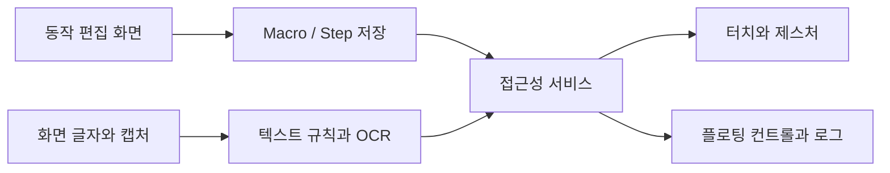

<div align="center">

# 🤖 PXE Project

화면의 글자와 접근성 정보를 읽어 조건에 맞는 터치를 실행하는 Android 앱입니다.

**기술 분류:** Android 자동화 › 접근성·화면 인식 › OCR·조건 기반 터치 실행

`Android`
`Java`
`OCR`

[빠른 시작](#quick-start) · [저장소 구성](#repository-structure) · [동작 구성](#data-settings)

[핵심 구성](#input-processing-output)

</div>

## 최신 16차 · 1.6.0

[16차 소스와 빌드 안내](../../../../../../16%EC%B0%A8/source/README.md) · [변경과 검증 범위](docs/versions/16차.md)

다음 글자가 나타나면 진행하는 선택형 적응 대기, 단계별 실제 시간 표시, 정지·일시정지 경합 수리와 OBJ 기반 입체 모델을 추가했습니다. 기존 매크로의 대기 수치와 저장 형식, 이전 차수는 보존합니다. 나눔고딕 Bold와 기존 OFL 고지를 포함합니다.

개인 키·프로필·실행 원문·APK·캐시는 공개하지 않습니다. 실제 게임·블루스택 다중 실행·24시간 운용의 성공률은 별도 측정이 필요합니다.

<a name="overview"></a>

<a name="latest-changes"></a>
## ✨ 이전 14차의 변화와 차수 탐색

**14차 · 이전 보관본** — 청록 UI·터치 영역과 글자 재확인 분기

- 청록색 UI·48dp 터치 영역·시스템 모션 설정을 적용합니다. 정지·일시정지·대상 앱 경계는 UI 변경과 함께 확인해야 합니다.
- TEXT_TAP 재확인에서 글자가 사라지면 waitForever 상태의 원래 대기를 재개합니다. TEXT_NOT_FOUND 상세 오류 기록도 13차와 구별됩니다.

[🔍 14차 자료 자세히 보기](docs/versions/14%EC%B0%A8.md) · [🗂️ 전체 차수 의미 비교](docs/VERSIONS.md)

### 🧭 차수 바로가기

[기본](docs/versions/%EA%B8%B0%EB%B3%B8.md) · [1차](docs/versions/1%EC%B0%A8.md) · [3차](docs/versions/3%EC%B0%A8.md) · [4차](docs/versions/4%EC%B0%A8.md) · [5차](docs/versions/5%EC%B0%A8.md) · [6차](docs/versions/6%EC%B0%A8.md) · [8차](docs/versions/8%EC%B0%A8.md) · [9차](docs/versions/9%EC%B0%A8.md) · [10차](docs/versions/10%EC%B0%A8.md) · [11차](docs/versions/11%EC%B0%A8.md) · [12차](docs/versions/12%EC%B0%A8.md) · [13차](docs/versions/13%EC%B0%A8.md) · [14차](docs/versions/14%EC%B0%A8.md) · [15차](../../../../../../15%EC%B0%A8/source/README.md) · [16차](../../../../../../16%EC%B0%A8/source/README.md) · [실행점검/2차](docs/versions/%EC%8B%A4%ED%96%89%EC%A0%90%EA%B2%80-2%EC%B0%A8.md)

코드/의 차수 밖 NEX 자료와 실행점검/2차는 별도로 안내합니다. 실행점검/2차는 제품 앱의 2차가 아닙니다.

| 관심 있는 내용 | 바로가기 |
| :--- | :--- |
| 코드를 먼저 보고 싶어요 | [최신 원본 폴더](../../../../../../16%EC%B0%A8/source) |
| 이전과 무엇이 다른가요? | [차수별 해설과 근거](docs/VERSIONS.md) |
| 어떻게 실행하나요? | [준비 조건과 실행 제약](#quick-start) |


<a name="preview"></a>

<a name="input-processing-output"></a>

## 🔄 입력·처리·출력

| 단계 | 이 프로젝트에서 다루는 내용 |
| :--- | :--- |
| 📥 입력 | 동작 목록·화면 글자·좌표 |
| ⚙️ 처리 | AccessibilityService·ML Kit OCR·글자 조건·제스처 |
| 📤 출력 | 터치 실행·플로팅 상태·로그 |


---

<a name="introduction"></a>

## ✨ 프로젝트 소개

반복하는 터치와 화면 확인을 동작 목록으로 구성하는 안드로이드 프로젝트입니다.

PXE는 동작 목록을 편집·저장하고 접근성 서비스에서 실행합니다. 좌표 입력뿐 아니라 화면의 글자를 찾아 터치하거나 기다리고, 조건에 따라 다음 동작을 바꾸는 흐름을 구성합니다.

| 기능 | 구현 내용 |
| :--- | :--- |
| 터치 동작 | 단일·두 번·길게 누르기, 스와이프, 다중 터치 |
| 제스처 | 곡선·확대·축소·녹화 경로 |
| 글자 조건 | 글자 터치·대기·분기·확인 |
| 화면 인식 | 접근성 노드와 ML Kit 한국어 OCR |
| 실행 제어 | 시작·정지·일시정지, 반복과 대기 시간 |
| 플로팅 화면 | 실행 상태와 화면 영역 선택 |



<a name="repository-structure"></a>

## 📁 저장소 구성

초기 코드와 여러 개발 단계의 주요 경로는 다음과 같습니다.

```text
.
├── 코드/
├── 1차/ … 15차/
├── 15차/source/
│   ├── 빌드.ps1
│   ├── app/src/main/java/kr/yunseok/touchmacro/
│   │   ├── MainActivity.java
│   │   ├── MacroService.java
│   │   ├── Macro.java
│   │   ├── Step.java
│   │   ├── FloatingController.java
│   │   ├── TextRules.java
│   │   └── WatchConfig.java
│   ├── app/src/androidTest/java/
│   └── tools/
└── docs/VERSIONS.md
```

- [15차 소스](../../../../../../15%EC%B0%A8/source), [동작 모델](../../../../../../15%EC%B0%A8/source/app/src/main/java/kr/yunseok/touchmacro/Step.java).
- [접근성 실행 서비스](../../../../../../15%EC%B0%A8/source/app/src/main/java/kr/yunseok/touchmacro/MacroService.java).
- [기기 검사 코드](../../../../../../15%EC%B0%A8/source/app/src/androidTest/java), [버전 기록](docs/VERSIONS.md).

<a name="implementation"></a>

## 🧩 주요 기술과 실행 흐름

저장한 동작은 `MacroService`가 실행합니다. 이 서비스는 Android `AccessibilityService`를 확장하고 스크린샷과 OCR 요청의 상태를 관리합니다. 서비스가 연결 해제되거나 화면 방향이 바뀌는 경로에서 실행 상태를 정리합니다. `Step.validate()`는 좌표·시간·반복·분기 번호·텍스트 조건을 검사합니다.

접근성 권한은 실제 기기에서 사용자가 설정해야 합니다. 앱의 코드 존재만으로 다른 앱의 화면 제어 권한이 자동 부여되는 것은 아닙니다.

### 🔒 저장·인식 요청의 경계

매크로는 SharedPreferences의 JSON으로 저장하며 불러오기 실패 시 예제로 돌아가는 경로가 있습니다. `SetupFlow`의 초안·백업 보존 기능과 별개로 모든 실패에서 무손실 복구를 보장하지는 않습니다.

`CaptureRequests`는 미완료 캡처를 최대 2개로 제한합니다. 15차의 `CapturePacer`는 실제 응답 뒤 API30에서 1.1초, API31 이상에서 0.5초를 기준으로 기다립니다. 간격 거절 시 최대 12초까지 늘리고 성공 뒤 기준까지 점진적으로 회복합니다. `QueryLane`은 화면 읽기 동시 요청을 막으며, `WatchGate`는 두 번 이상의 연속 부재와 최소 부재 시간을 만족해야 중복 진입 잠금을 풉니다.

`TextRules`는 NFKC·공백·소문자 정규화를 거친 일치·포함 비교와 정규식 검색을 제공합니다. 제스처 경로는 1~20개, 경로당 점은 1~512개로 검사합니다. 원본 14차 개발 구성은 Java 17·AGP 8.9.1·Gradle 8.13·Android SDK 35이며, 최소 Android API 30과 ML Kit 한국어 인식 16.0.1을 사용합니다.

### 🗂️ 차수별로 달라진 동작

| 차수 | 주요 변화 |
| :--- | :--- |
| 1~3차 | 초기 서비스 패널에서 별도 제어창으로 분리하고 제스처 녹화·곡선·다중 터치·영역과 위치 보정을 확장합니다. |
| 4~5차 | 새로고침→글자 탐지→선택 매크로→복귀 루프를 추가합니다. 5차의 탐지 반복 기본 15회는 저장 매크로의 전체 반복과 곱하지 않습니다. |
| 6차 | 최대 6개 우선 영역, 대상 앱·중복 잠금·완료 후 대기, 단계별 안내와 임시 녹화를 도입합니다. |
| 8~9차 | 별도 화면 읽기와 캡처 간격 조절을 추가합니다. 플로팅 재생은 저장된 탐지 설정을 실행하며 설정이 없으면 시작하지 않습니다. |
| 10~11차 | 네이티브 하단 탐색·카드 UI, 창 이벤트 기반 대상 앱 확인, AUTO 모드의 읽기 지연 시 OCR 전환을 추가합니다. |
| 12~13차 | 계속 기다리기, 늦은 응답 폐기, 접힌 패널의 정지 버튼, 캡처 최대 2개·OCR Task 최대 1개와 연결 종료 처리를 보강합니다. |
| 14차 | 청록색 UI·48dp 터치 영역·시스템 모션 설정을 적용하고, 글자 재확인에서 대상이 사라졌을 때 원래 대기를 재개하는 분기를 수정합니다. |
| 15차 | 목록·개별 인식 방식의 기본 노출과 범위 안내, 캡처 간격의 정상 회복, 활성 탐지 반복 대기 축소, 선택형 즉시 진입과 설정 접기를 적용합니다. 전체 OCR·중심점 필터와 기존 보호는 유지합니다. |

위자드 기본값은 완료 후 새로고침 대기 켜짐(`waitForRefresh=true`), 중복 방지 꺼짐(`preventDuplicate=false`)입니다. 완료 후 대기와 글자 부재에 따른 중복 잠금 해제는 서로 다른 설정입니다.

### 📝 기록에 남는 정보

일반 실행 기록은 최근 150줄을 보관하며 인식한 본문과 탐지 문구가 들어갈 수 있습니다. 사용자가 저장하는 로그와 시험 도구의 화면·인식 결과를 외부에 공유할 때 이 내용을 확인해야 합니다. 별도 `ErrorJournal`은 128KiB 파일 두 개를 순환하며 오류 종류·상태를 기록합니다. 일반 로그에는 인식 본문이 남을 수 있어 공유 전에 개인정보를 확인해야 합니다.

<a name="quick-start"></a>

## 🚀 빠른 시작

최신 15차는 소스·Gradle 설정·Manifest·리소스와 글꼴 라이선스를 포함합니다. JDK17과 Android SDK35를 준비한 뒤 [15차 빌드 안내](../../../../../../15%EC%B0%A8/source/README.md)를 따릅니다. 과거 14차 공개 사본에서 일부 빌드 입력이 빠졌던 상태와 구분합니다.

```powershell
cd 15차/source
.\gradlew.bat :app:assembleRelease :app:testDebugUnitTest :app:lintDebug
```

PC용은 `-PNEX_PC`로 ARM64와 x86_64를 함께 빌드합니다. 납품용 `빌드.ps1`은 로컬 전용 연결과 기존 개인 키를 요구합니다. 일반 개발 구성은 개인 서명이 없으면 debug 서명을 사용하므로 기존 개인 서명 앱의 업데이트를 보장하지 않습니다. 키는 공개하지 않습니다.

15차의 실제 로컬 검증과 한계는 변경 기록에 따로 적습니다. Android 소유 시험 장치의 결과를 사용자 블루스택이나 24시간 무중단 검증으로 표현하지 않습니다.

<a name="data-settings"></a>

## 📊 데이터와 동작 구성

| 항목 | 15차 코드의 구성 |
| :--- | :--- |
| 저장 스키마 | `schema = 1` |
| 동작 수 | 1~500개 |
| 좌표 | 화면 기준 0~100% |
| 텍스트 비교 | 포함·일치·정규식 |
| 텍스트 소스 | AUTO·ACCESS·OCR |
| 실패 동작 | 정지·건너뛰기·뒤로 재시도·재시도·스크롤 재시도 |
| 시간·반복 | 개별 동작과 전체 매크로 설정을 각각 검사 |

개별 동작의 계속 기다리기와 즉시 진행은 글자 터치·글자 대기에 적용됩니다. 15차 목록 설정의 인식 즉시 들어가기는 별도 선택입니다. UI 설명과 내부 직렬화 값을 바꿀 때는 저장된 매크로와의 호환성도 확인해야 합니다.

<a name="troubleshooting"></a>

## 🛠️ 문제 해결

| 증상 | 확인할 내용 |
| :--- | :--- |
| 실행 서비스가 연결되지 않음 | 실제 기기의 PXE 접근성 설정 |
| OCR이 응답하지 않음 | 캡처·인식 단계와 오류 기록, 기기 지원 |
| 좌표가 맞지 않음 | 화면 방향과 0~100% 좌표·검색 영역 |
| 동작 저장이 거부됨 | `Step.validate()`의 시간·좌표·분기 범위 |
| 빌드 입력 누락 | Gradle 설정·manifest·리소스·SDK·서명키 |
| 화면 위 컨트롤이 사라짐 | 서비스 연결과 창 토큰 상태 |

---

<div align="center">

**동작을 구성하고, 상태를 확인하며 실행합니다.**

</div>
